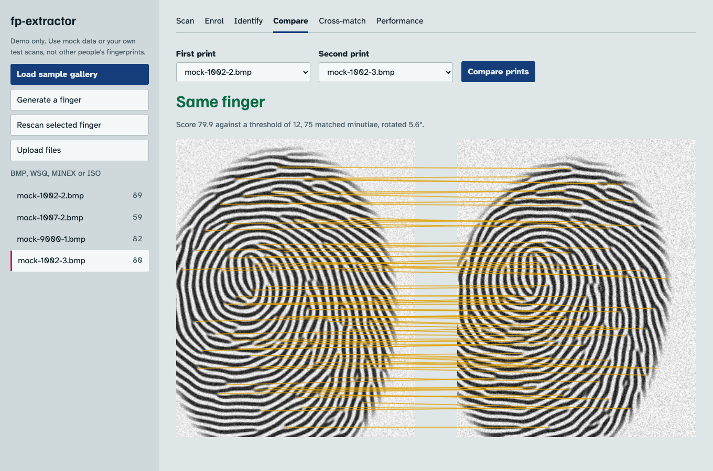
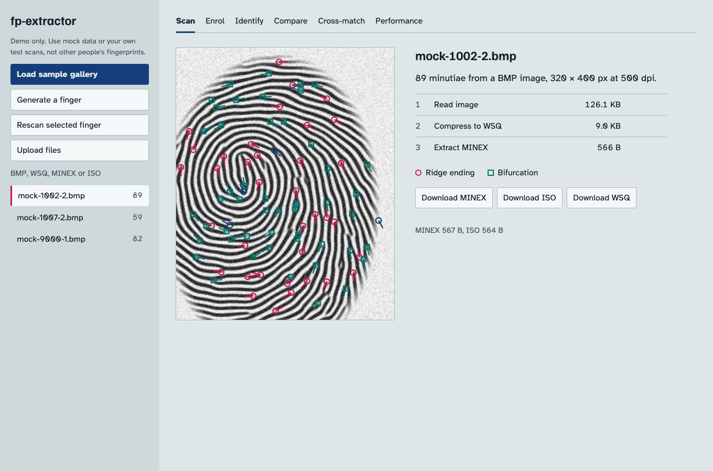
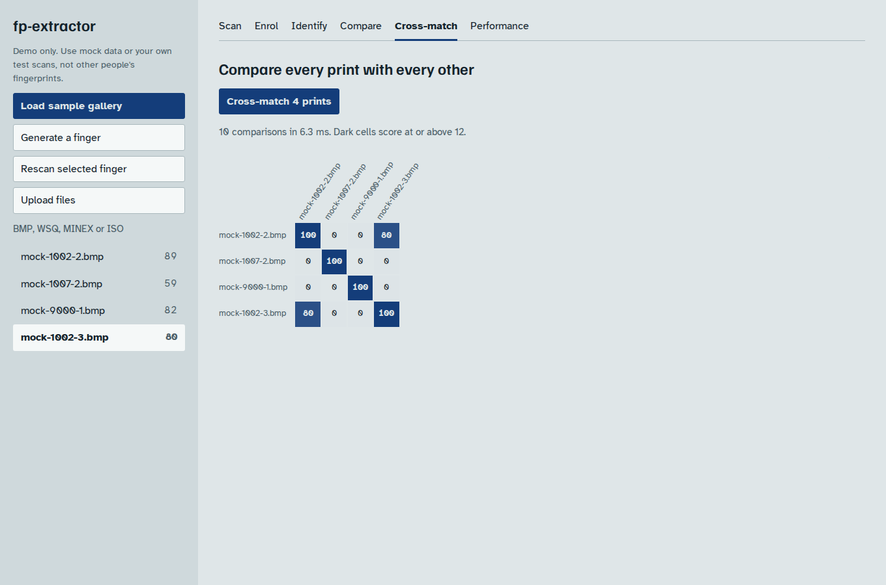
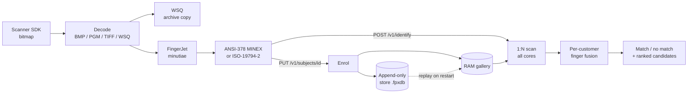

# fp-extractor

Fingerprint toolkit and identification server, independent of the scanner:

**scanner bitmap → WSQ → ANSI-378 ("MINEX") / ISO-19794-2 template → 1:1 match / 1:N search over millions.**

* **Extraction** with [FingerJet FX OSE](https://github.com/FingerJetFXOSE/FingerJetFXOSE) (DigitalPersona's open-source extractor)
* **WSQ** compression with the NIST NBIS reference codec
* **Matching** of ANSI-378 / ISO-19794-2 templates from any vendor (FingerJet has no matcher; this repo adds one)
* **1:N identification**: 1,000,000 synthetic templates in **~5 s on an Apple M1** (~1.5 GB RAM), see [capacity tables](docs/CAPACITY.md)
* **CLI** (`fpx`), **REST server** (`fpx-server`), **C API** (`libfpx.so`) for Python / C# / Java / Go
* Tests, benchmarks and demos use **synthetic fingerprints**, so no real biometric data is needed

> Status: the matcher is validated on synthetic data only; **calibrate thresholds
> on your own scanner data before production** ([docs/MATCHING.md](docs/MATCHING.md#calibration)).
> For million-scale 1:N, enrol and search **two fingers per customer**
> (supported by the server and CLI); single-finger margins at 1 M are thin
> ([docs/SCALING.md](docs/SCALING.md)).

## See it working



```bash
./scripts/demo.sh    # needs CMake, a C++17 compiler and Node.js
```

Open http://127.0.0.1:8080 and choose **Load sample gallery**. Upload BMP, WSQ, MINEX or ISO
files, enrol customers, identify with up to 10 fingers, compare two prints, and cross-match a list.

| Convert and inspect | Cross-match |
|---|---|
|  |  |

See also: [architecture](docs/ARCHITECTURE.md), [capacity and hardware](docs/CAPACITY.md), [roadmap](docs/ROADMAP.md).

## End-to-end flow



| Step | What happens | CLI | REST / C API | Code |
|---|---|---|---|---|
| 1. Capture | The scanner SDK gives a bitmap. Most sensors are 500 dpi; pass `--dpi` / `"dpi"` if the file does not say. | | | |
| 2. Decode | BMP (1/4/8/24/32-bit), PGM, uncompressed TIFF or WSQ becomes an 8-bit grey image. | `fpx info` | | `image.cpp` |
| 3. Archive | Optional WSQ copy, about 14:1 smaller (126 KB BMP → 9 KB). | `fpx convert` | `/v1/extract` `"wsq": true`, `fpx_image_to_wsq()` | `wsq.cpp` (NIST NBIS) |
| 4. Extract | FingerJet finds ridge endings and bifurcations and writes a ~0.5 KB template. | `fpx extract` | `/v1/extract`, `fpx_extract_from_image()` | `extractor.cpp`, `template.cpp` |
| 5. Enrol | Up to 10 fingers per customer are appended to the store, then compiled into the RAM gallery. | `fpx enroll` | `PUT /v1/subjects/{id}` | `store.cpp`, `gallery.cpp` |
| 6. Identify | Each probe finger is compared with every enrolled finger at the same position, on all cores. Concurrent searches are queued first come, first served. | `fpx identify` | `POST /v1/identify` | `gallery.cpp`, `matcher.cpp` |
| 7. Decide | Two fingers presented: match if both score ≥ 12, or one scores ≥ 30. One finger: match if it scores ≥ 18. | | response `match`, `candidates` | `FusionPolicy` |
| 8. Verify (1:1) | Same comparison against one claimed customer, threshold 12. | `fpx match` | `POST /v1/verify`, `/v1/match`, `fpx_match()` | `matcher.cpp` |

Devices that can run native code do steps 2–4 themselves with `libfpx` (or any vendor SDK that
writes ANSI-378 / ISO-19794-2) and send only the template. Thin clients send the image and the
server does steps 2–4. Several `fpx-server` processes can sit behind the Go gateway
(`examples/go-gateway`), which keeps all fingers of a customer on the same shard.

## Test everything with one command

```bash
scripts/run-all.sh            # everything except sanitizers and 1 M benchmarks (~15 min)
scripts/run-all.sh --quick    # fast loop: no Docker, smaller benchmarks and load test (~5 min)
scripts/run-all.sh --full     # also ASan/UBSan and the 1 M benchmarks (~30 min, ~4 GB RAM)
scripts/run-all.sh --only web,examples      # or --skip docker
```

| Stage | What it checks |
|---|---|
| `tools` | compilers and tools; installs CMake for the user (uv / pipx / pip) if it is missing |
| `build` | Release build with no compiler warnings in project code |
| `unit` | `ctest`: 35 doctest cases, CLI smoke tests, REST API end-to-end tests including restart persistence |
| `sanitizers` | Debug build with AddressSanitizer and UBSan, the whole suite, including the server processes (`--full`) |
| `accuracy` | `fpx eval --synthetic`: EER, FNMR, FMR through the real FingerJet pipeline; fails on any false match |
| `bench` | `fpx bench`, 1 and 2 fingers per customer; fails on a false alarm |
| `examples` | `fpx demo`, the C++ example, Python ctypes, the full CLI walk-through, the Python REST client, every route in `requests.http` |
| `gateway` | Go gateway in front of two shards: enrol, spread, identify, verify, auth, delete (`tests/gateway_e2e.py`) |
| `load` | `fpx gendb` + `tests/load_test.py`: HTTP throughput and p50/p95/p99 latency at 1, 4, 16 clients; fails on errors, false matches, or any answer that differs from the single-client answer |
| `web` | web unit tests, production build, Playwright end-to-end journey with screenshot comparison |
| `docker` | image build (runs the tests inside), container HEALTHCHECK and auth, compose with 2 shards + gateway |
| `deploy` | shellcheck and compose file validation |

Logs, a `summary.md`, the load test JSON and the screenshots are written to `test-reports/<timestamp>/`.
Screenshot baselines are kept per OS (`apps/web/e2e/snapshots/*-linux.png`). On a new OS the first run
writes them; review and commit them.

---

## Quick start (Linux / macOS / WSL)

Requirements: C++17 compiler (GCC ≥ 9 or Clang ≥ 10), CMake ≥ 3.16, git, network
access on the first build (dependencies are fetched and pinned).

```bash
git clone https://github.com/rabbicse/fp-extractor
cd fp-extractor
cmake -S . -B build -Wno-dev            # Release by default
cmake --build build -j
(cd build && ctest --output-on-failure)  # 35 test cases + CLI smoke tests + REST e2e
```

Ubuntu packages: `sudo apt install build-essential cmake git`.

### 1. See it work: no scanner needed

```bash
build/fpx demo --out fpx-demo
```

Generates 3 synthetic fingers × 2 impressions, then runs each through
BMP → WSQ → ISO/ANSI and prints a score matrix and 1:N results:

```
== 3. Score matrix (genuine pairs on the diagonal blocks)
          f1_0  f1_1  f2_0  f2_1  f3_0  f3_1
   f1_0   100.0   79.8    0.1    0.5    0.4    0.1
   f1_1    79.8  100.0    0.0    0.0    0.1    0.3
   f2_0     0.1    0.0  100.0   72.4    0.1    0.4
   ...
== 4. 1:N: enrol impression 0 of each finger, identify impression 1
   probe finger1_1 -> finger1 (score 79.8)
```

### 2. Your scanner's bitmap → WSQ → MINEX template

```bash
build/fpx info    scan.bmp                              # size / dpi / format
build/fpx convert scan.bmp scan.wsq                     # WSQ (≈15:1)
build/fpx extract scan.bmp -o scan.ansi --format ansi   # ANSI-378 = MINEX format
build/fpx extract scan.bmp -o scan.iso  --format iso    # ISO-19794-2
build/fpx info    scan.ansi -v                          # list minutiae
```

Inputs: BMP (1/4/8/24/32-bit), PGM, uncompressed TIFF, WSQ. Use `--dpi N` if
the file doesn't carry the sensor's real resolution (most are 500 dpi).

### 3. Match (this was the missing piece)

```bash
build/fpx match scan.ansi other.bmp -v     # templates and/or images
# score:     79.80
# threshold: 12.00
# decision:  MATCH
```

### 4. 1:N identification

```bash
# two fingers per customer: right index (2) and left index (7)
build/fpx enroll   --db customers.fpxdb --id customer-001 r_index.ansi l_index.bmp --fingers 2,7
build/fpx identify --db customers.fpxdb probe_r.bmp probe_l.bmp --fingers 2,7 --top 5
build/fpx bench --gallery 1000000 --fingers 2   # 1 M synthetic customers x 2 fingers
```

### 5. Server

```bash
FPX_API_KEY=change-me build/fpx-server --db customers.fpxdb --port 8080
```

A *finger* in a request is `{"position": 1..10, "template": b64}` or
`{"position": 1..10, "image": b64, "dpi"?: 500}`. Positions follow ISO 19794-2:
1 right thumb, 2 right index, 3 right middle, 4 right ring, 5 right little,
6–10 the same on the left hand, 0 = unknown.

| Method | Path | Body (JSON, binary fields base64) | Result |
|---|---|---|---|
| GET | `/healthz` | | `{"status":"ok"}` |
| GET | `/v1/stats` | | subjects, templates, memory, thresholds/policy |
| POST | `/v1/extract` | `{"image", "dpi"?, "format"?: "iso"\|"ansi", "position"?, "wsq"?: true}` | `{"template", "minutiae", "wsq"?}` |
| PUT | `/v1/subjects/{id}` | `{"fingers": [finger, ...]}` | enrol; the customer ends up with exactly these fingers |
| PUT | `/v1/subjects/{id}/fingers/{pos}` | `{"template"}` or `{"image"}` | add / replace one finger |
| GET | `/v1/subjects/{id}` | | `{"id", "fingers":[{position, minutiae}]}` |
| DELETE | `/v1/subjects/{id}` · `/v1/subjects/{id}/fingers/{pos}` | | remove customer / one finger |
| POST | `/v1/identify` | `{"fingers": [finger, ...], "top_k"?: 5}` | `{"match", "id", "candidates":[{id, score, match, fingers_matched, fingers:[{position, enrolled_position, score}]}], "elapsed_ms"}` |
| POST | `/v1/verify` | `{"id", "fingers": [finger, ...]}` | `{"score", "match", "fingers_matched", "fingers"}` |
| POST | `/v1/match` | `{"a", "b"}` (two templates) | `{"score", "match"}` |
| POST | `/v1/admin/compact` | | rewrite the store without deleted/replaced records |

Single-finger requests from v2.0 (`{"template": ...}` without `fingers`) still work.

**Two-finger decision rule** (server flags in brackets): a customer matches when
**both** presented fingers score ≥ 12 (`--finger-threshold`, `--min-fingers 2`),
or one finger alone scores ≥ 30 (`--strong-single-threshold`, e.g. the other
finger was smudged). With only one finger presented, the stricter
single-finger rule applies: score ≥ 18 (`--identify-threshold`). Each probe
finger is compared only with enrolled fingers of the same position, so two
fingers cost two comparisons per customer, not four.

All requests need `X-API-Key` when a key is set. Clients:
`examples/python/client.py`, `examples/http/requests.http`.

**Device-agnostic by design:** the device converts the bitmap to a template
(with `libfpx`, or any vendor SDK that outputs ANSI-378/ISO-19794-2) and
sends only that ~0.5 KB. Thin clients may send the image instead.

### 6. Docker

```bash
docker build -f docker/Dockerfile -t fp-extractor .
docker run -p 8080:8080 -e FPX_API_KEY=change-me -v fpx-data:/data fp-extractor
# sharded: 2 matcher shards + Go gateway on :9090
docker compose -f docker/docker-compose.yml --profile sharded up --build
```

### 7. Automatic deployment

Every push to `master` runs all tests, builds the Docker image, publishes it to
`ghcr.io/rabbicse/fp-extractor`, and deploys it over SSH to your server, with
a health check and automatic rollback. Setup takes three GitHub settings and
one SSH key: [docs/DEPLOYMENT.md](docs/DEPLOYMENT.md).

---

## Using it from code

**C++**

```cpp
#include "fpx/fpx.hpp"
fpx::GrayImage img = fpx::load_image("scan.bmp");             // BMP/PGM/TIFF/WSQ
std::vector<uint8_t> wsq = fpx::wsq_encode(img);               // archive
fpx::ExtractOptions o; o.format = fpx::TemplateFormat::Ansi378_2004;
fpx::ExtractResult t = fpx::extract(img, o);                   // t.record = MINEX bytes
fpx::Gallery g;  g.insert("customer-1", t.parsed);
auto r = g.identify(fpx::extract(fpx::load_image("probe.bmp")).parsed, {5});
```

Full example: `examples/cpp/pipeline.cpp`.

**Python / C# / Java / Go**: use the C API in `include/fpx/fpx_c.h`
(`libfpx.so`). Python example: `examples/python/fpx_ctypes.py`.

---

## Documentation

| Doc | Contents |
|---|---|
| [docs/ARCHITECTURE.md](docs/ARCHITECTURE.md) | components, data flow, Go vs C++, security, licensing |
| [docs/MATCHING.md](docs/MATCHING.md) | the matching algorithm, calibration, improving accuracy |
| [docs/SCALING.md](docs/SCALING.md) | 1 M+ identification: benchmarks, RAM, database choice, sharding |
| [docs/TESTING.md](docs/TESTING.md) | step-by-step testing: unit tests, manual walk-through, accuracy eval, benchmarks |
| [docs/DEPLOYMENT.md](docs/DEPLOYMENT.md) | GitHub Actions auto-deployment (GHCR image, SSH deploy, health check, rollback), server setup |

## Repository layout

```
include/fpx/        public C++ API + C API (fpx_c.h)
src/core/           image I/O, WSQ, extractor, template codec, matcher, gallery, store, synthetic
src/cli/            fpx command-line tool
src/server/         fpx-server REST API
tests/              doctest unit + integration tests
examples/           C++, Python (ctypes + REST), HTTP requests, Go sharding gateway
third_party/        NBIS WSQ subset (public domain)
cmake/              dependency pinning (FingerJet, httplib, json, doctest)
docker/             Dockerfile, docker-compose (single + sharded)
deploy/             production compose file + remote deploy script (used by CI/CD)
docs/               architecture, matching, scaling, testing
```

## What's new in v2.1

* **Two-finger (multi-finger) enrolment and search**: customers have up to
  10 finger slots; identify/verify accept several fingers and fuse them per
  customer. At 1 M customers × 2 fingers: 20/20 genuine accepted, 0 false
  alarms, ~10 s per search on 4 cores. v2.0 single-template requests and
  stores keep working unchanged.
* Per-finger REST routes, `GET /v1/subjects/{id}`, online
  `POST /v1/admin/compact`.
* **Auto-deployment** (`.github/workflows/deploy.yml`): tests → Docker image
  on GHCR → SSH deploy with health check and automatic rollback.
* Fixed the Docker `HEALTHCHECK` (needs bash for `/dev/tcp`) and added
  `.dockerignore`.

## What changed from v1

* **Bug fixed:** v1 passed the whole BMP *file* (header, palette, bottom-up
  padded rows) to FingerJet as if it were raw pixels, so the templates were
  extracted from a garbled image. v2 decodes the BMP properly.
* **Bug fixed:** v1's "match score" was `memcmp` of two templates; it only
  tells you whether the bytes are identical. v2 has a real minutiae matcher.
* Hard-coded paths and prebuilt `.so` files are replaced by a reproducible
  CMake build; generated build files (CMakeCache, Makefile, .idea) were removed.

## Licenses

MIT for this repository's code. FingerJet FX OSE is **LGPL-3.0** (built as a
separate shared library `libFRFXLL.so`); NBIS is public domain; cpp-httplib,
nlohmann/json and doctest are MIT. Not MINEX-certified: NIST certification is
a separate formal process.
